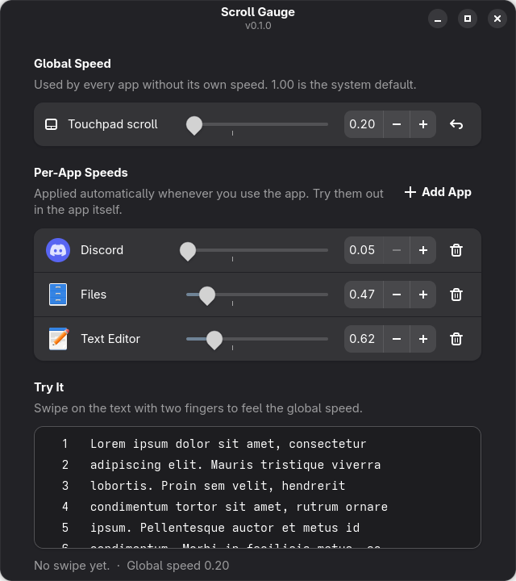

# Scroll Gauge

A GNOME app for setting touchpad scroll speed on GNOME Wayland: one global speed, per-app speeds, and a demo page to feel the result while you drag the slider.

WSF's own window only sets one global speed, and Touchpad Speed Control's settings only set per-app speeds, and neither lets you try the speed while you adjust it. Scroll Gauge puts both in one window with a live demo.



## Where it runs

Linux, GNOME on Wayland, any distribution. Not GNOME on X11 or other desktops (WSF is GNOME Wayland only). Tested on Fedora 44, GNOME 50.

## Requirements

- Python 3.11+ with PyGObject, GTK 4 and libadwaita 1.4+ (already installed on GNOME). If missing: `sudo dnf install python3-gobject libadwaita` (Fedora), `sudo apt install python3-gi gir1.2-adw-1` (Ubuntu/Debian), `sudo pacman -S python-gobject libadwaita` (Arch)
- [WSF](https://github.com/daniel-g-carrasco/wayland-scroll-factor), enabled with `wsf enable`
- Optional: the [Touchpad Speed Control](https://extensions.gnome.org/extension/10008/touchpad-speed-control/) GNOME extension, for per-app speeds. It switches to each app's speed as you use it. Without it, only the global speed is available. See [Install](#install).

## Install

```bash
git clone https://github.com/Vikmanou/scroll-gauge.git
cd scroll-gauge
pip install .
```

Optional, for per-app speeds: install Touchpad Speed Control (GNOME asks you to confirm):

```bash
gdbus call --session --dest org.gnome.Shell.Extensions --object-path /org/gnome/Shell/Extensions \
  --method org.gnome.Shell.Extensions.InstallRemoteExtension touchpad-speed-control@ritesh
```

## Usage

Open Scroll Gauge from the app grid, or run `scrollgauge`.

- **Global speed:** used by every app without its own speed.
- **Per-app speeds:** starts with Files and Terminal. Pick an app, press Add, then drag its slider. Touchpad Speed Control switches to it whenever you use that app, so test it in the app itself.
- **Try it:** swipe on the demo text to feel the global speed. Changes apply straight away, and the window shows how many lines your last swipe moved.

Changes save automatically.

## Limitations

- The demo only shows the global speed. Apps scale scrolling differently, so the same speed can still feel a little different elsewhere.
- Per-app speeds need Touchpad Speed Control.
- Touchpad only. Mouse wheel scrolling isn't affected, because WSF doesn't change it.
- Horizontal scrolling gets the same speed as vertical.

## Development

```bash
pip install -e '.[test]'
pytest
```

## License

MIT
